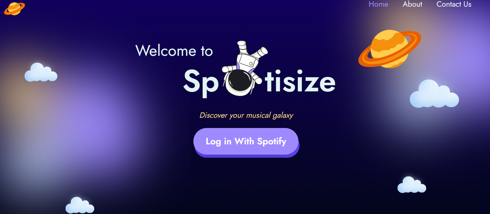
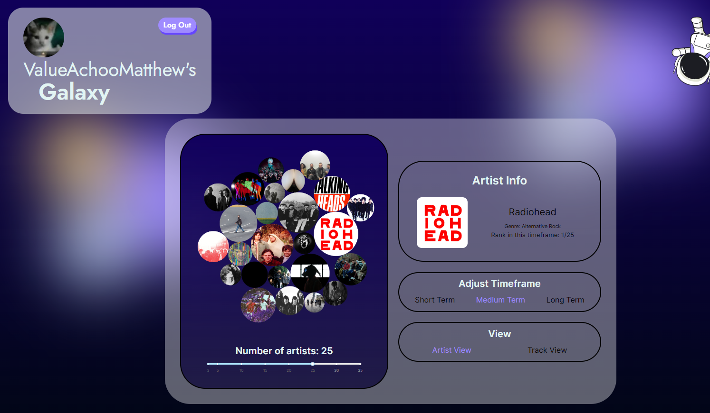
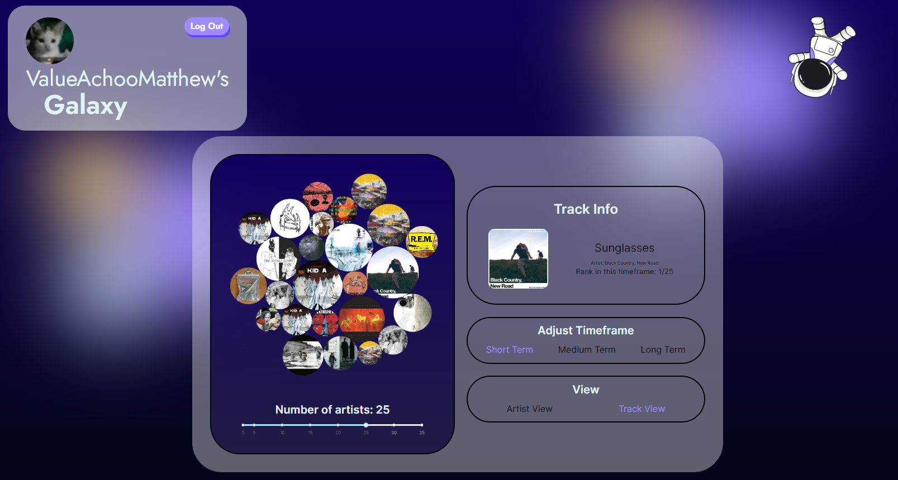

# Welcome to Spotisize!

Spotisize is a project dedicated to visualizing the music that makes your world,
or rather galaxy, go 'round. On the Spotisize website, you can see your
favourite artists and songs come to life as interactive bubbles scaled based on
your listening trends.

Try it at https://spotisize.vercel.app

    |   |     |
| ------------------------------ | ------------------------------ | -------------------------------- |

# Contributing

Spotify changing their API is a known phenomenon, and we may miss it. So we encourage bug reports, as long as it isn't the same exact one. The GitHub search bar is quite good these days.

# Code of Conduct

Be kind to other ppl 👍
